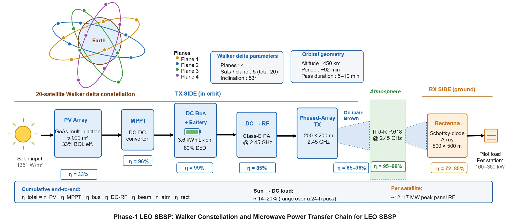
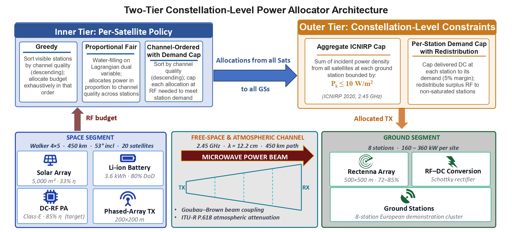

# Summary of the Space-based-solar-power-AEL-LAB-SBSP-
The main purpose of this work is to formulate constellation-level power allocation as a two-tier scheduling problem and evaluate it in a physically grounded, end-end-end simulation of a 20-satellite Walker constellation beaming 2.45 GHz microwave power to an eight-station cluster, with propagation simulated over 24 hours using a coupled orbital, thermal, battery, and wireless power transfer channel model.

---

## Contents
- [System Model](#system-model)
- [Two-Tier Allocator Architecture](#Two-Tier-Allocator-Architecture)
- [Repository Structure](#repository-structure)
- [Installation](#installation)
- [Usage](#usage)
- [Results](#results)
- [License](#license)
---

## 1. System Model
The proposed framework consists of a space segment and a ground segment, linked by an maximum power transfer (MPT) chain operating at $2.45 \text{GHz}$. In an example 20-satellite Walker delta constellation, each satellite carries a $5000m^2$ GaAs multi-junction PV array operating at 33\% BOL efficiency. Its output is conditioned by a maximum-power-point-tracking (MPPT) DC–DC converter  ($\eta_{\mathrm{MPPT}} = 96\%$) and buffered by a $3.6\text{kWh}$ lithium-ion battery at 80\% depth of discharge (DoD). It is then converted to microwave power by a Class-E PA target ($\eta_{\mathrm{DC-RF}} = 85$\%) 
and radiated through a $200\\mathrm{m} \times 200\\mathrm{m}$ phased-array transmit aperture. The atmospheric propagation losses are modeled using ITU-R~P.618 at \${2.45}\text{GHz}$, accounting for beam-coupling and attenuation variability as a function of elevation angle and weather for each pass. On a GS, each rectenna site consists of a $500\\mathrm{m} \times 500\\mathrm{m}$ Schottky-diode array rectenna (with a typical efficiency $\eta_{\mathrm{rect}} = 72\text{-}85$)\% 
delivering ${160}-{360} \text{kW}$ to a co-located pilot load, with the cumulative sun-to-load efficiency $\eta_{\mathrm{total}}$ ranging from 14\% - 20\% over a 24-hour operational average.

# Proposed Constellation geometry
The proposed constellation is described by the Walker delta notation $\mathcal{W}(T/P/F)$, where $T = S = 20$ is the total number of satellites, $P = 4$ is the number of equally spaced orbital planes, and $F = 1$ is the phasing parameter that determines the inter-plane mean-anomaly offset. Each plane contains $S/P = 5$ satellites, equally spaced in mean anomaly by $\Delta M = 2\pi/(S/P)$. We place each satellite in a circular orbit at an altitude of $h = \text{450 km}$. Please refer to the below figure for the system model.

---
## 2. Two-Tier Allocator Architecture 
At each time step, the constellation-level allocation problem is to assign, for every satellite $s \in \mathcal{S}$ and every GS $k \in \mathcal{K}$, a non-negative RF transmit power $P^{\mathrm{tx}}_{s,k} \geq 0$, subject to the per-satellite RF budget, the per-link safety cap, the per-station electrical demand, and the aggregate ICNIRP exposure limit. Two structural features of the SBSP setting distinguish this problem from beam-hopping and frequency-assignment work in the communication-satellite: the objective is to deliver DC power rather than to maximize aggregate data throughput, and the aggregate electromagnetic-safety constraint has no direct analogue in communication. The proposed two-tier architecture decomposes per-step allocation into a per-satellite ***inner tier*** that distributes each satellite's RF budget across its visible GSs and a constellation-level ***outer tier*** that enforces aggregate safety and demand caps by redistributing freed RF to non-saturated GSs. The architecture is benchmarked against a centralized LP upper bound to quantify the suboptimality of each inner-tier policy.

# ***Inner Tire:*** 
The inner tier operates independently on each satellite. The inner-tier task is to choose a non-negative allocation vector for all GS. We used and compare three policies that differ only in how the allocation is computed.

*  Greedy: The greedy policy sorts the visible GSs in descending order of effective link gain and allocates the satellite’s RF budget exhaustively in that order, taking at each step the minimum of the remaining budget and the GS’s per- link safety cap.
*  Proportional Fair (*PF*): The PF policy follows the shadow-price framework, in which Lagrangian dual variables for capacity constraints yield a fairness-preserving allocation.
*  Channel-Ordered with Demand Cap: The third policy is based on a demand-aware variant of the greedy heuristic. It sorts the visible GSs by ˜hs,k in descending order, as in the greedy heuristic, but caps each per-link allocation at the RF required to exactly meet the GS’s electrical demand.

# ***Outer Tire:***
The inner-tier output is a transmit matrix that satisfies all per-satellite constraints but may violate two aggregate constraints that couple decisions across satellites, such as the ICNIRP power-density cap at each GS and the per-station demand cap. The outer tier enforces both constraints sequentially.

Beside the ***inner tire*** and ***outer tire***, we also considered ***Centralized linear programming (LP) benchmark*** that bound the suboptimality of the heuristic policies, we compute a centralized LP benchmark that solves the entire constellation-level allocation problem at each time step. LP
approaches to satellite RA have been successfully demonstrated for dynamic frequency assignment in non-geostationary constellations; we adapt this methodology to the SBSP power-allocation setting. The overall Two-tier constellation-level power allocator architecture can be found below. The inner tier executes one of the proposed heuristic policies independently for each satellite, using only its locally visible set of GSs. The resulting per-satellite allocations are passed to the outer tier, which enforces the aggregate ICNIRP exposure cap and the per-station demand cap at the constellation level. The bottom strip provides physical context: the Walker constellation supplies the per-satellite RF budget to the inner tier; the free-space and atmospheric channel applies the Goubau–Brown beam-coupling and ITU-R P.618 models (Section III-B); and the GS cluster receives the outer tier’s allocated transmit powers for rectification to DC.

## 3. Repository Structure
There are basically 3 script files, 2 main figures and a readme file.

1. SBSP_env.py (All the proposed architecture and description can be found here) \
2. plot.py ( plot setting, dimension, size, color and allocator setting)\
3. main.py ( argparse paramters, evaluation and figure generation)\
4. allocator_arch_page-0001.jpg/ # proposed three allocator framework \
5. system_overview_page-0001.jpg (proposed Walker constellation) \
6. README.md # code working description

---
## 4. Installation

Clone the repository and install the dependencies:

pip install -r requirements.txt
Requirements (used packages for this project):\

torch==         2.11.0+cpu \
numpy==         2.2.6 \
scipy==         1.15.3 \
matplotlib==    3.10.8 \
tqdm==          4.67.3\

---

## 5. Usage

Check and update the SBSP_env.py file and fix the parameters according to environment. In this proposed work, we have assumed the walker constellation $\mathcal{W}(T/P/F)$, where we assume $20$ satellites and equally spaced into $P = 4$ orbital planes, and a phasing parameter offset $F = 1$ determines the inter-plane mean-anomaly. Each plane contains $S/P = 5$ satellites, equally spaced in mean anomaly by $\Delta M = 2\pi/(S/P)$. We place each satellite in a circular orbit at an altitude of $h = \text{450 km}$. Please refer to the below figure for the system model.
Key Findings:\
• Headline allocator performance at the canonical scenario: In Fig. 3, we showed 24-hour mean total delivered DC power, the Jain fairness index across the eight GS, and the worst-case per- station DMR for each of the four policies. \
• Per-Station 24-hour mean delivered DC power for each of the eight GS under each of the four policies.\
• The satellite visibility across all time steps with number of GSs visible within each satellite’s $5^{\circ}$ minimum-elevation mask\
The overall summary for all the proposed approaches:\
**The main finding is that the CO- DC policy, under the full two-tier architecture, consistently approaches the LP upper bound at low demand and across the tested demand range. In the headline scenario, it achieves a mean delivered DC within 2.58% of optimal and a Jain fairness index of 0.971. The greedy allocator performs competitively across the full architecture; however, it collapses to a 32.99% gap when the outer tier is removed, revealing its near-total reliance on redistribution passes that CO-DC largely handles internally. The PF deteriorates at every tested demand level and is not suitable for hard-demand SBSP settings. At high demand, greedy recovers and slightly outperforms CO-DC, whereas its fragility at low demand makes it a risky default choice. Overall, CO-DC under the two-tier architecture provides the best balance of performance, fairness, and robustness across operating regimes.*

---

## 6. Results
Please add the exact directory in plot_v4 and main.py to generate the figures. All the figures will go to Journal_figure folder. If any issue encounter during the simulation run time please don't hesitate to contact us:\
**Acknowledgment**: This work is performed in the Advanced Network and Embedded systems Lab under the supervision of Prof. Peng Hu at university of Manitoba.\
Please cite “A. iqbal, M. Alhassan and P. Hu, “Constellation-Level Power Allocation for Space-Based Solar Power: A Two-Tier Scheduling Framework with Optimality Bounds.”
